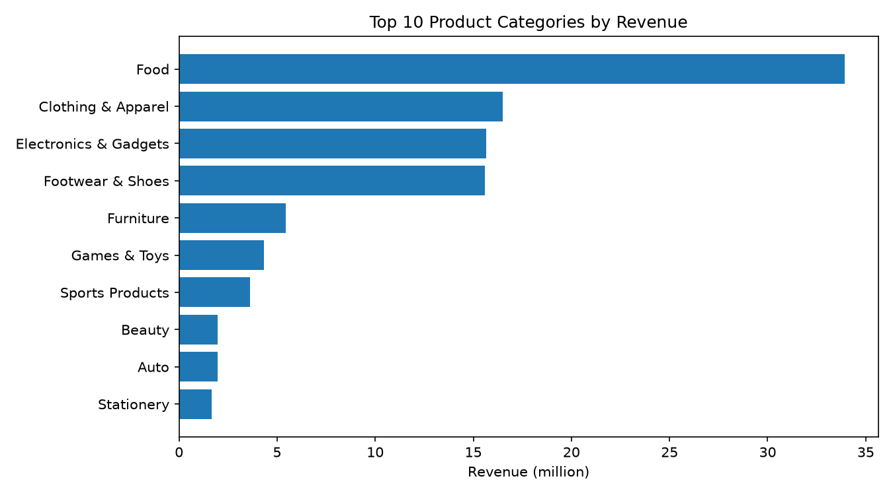

# Diwali Sales Analysis

Exploratory data analysis of Diwali sales data using Python (pandas, matplotlib).

> 🚧 Work in progress. Data cleaning is complete, exploratory analysis is in progress (Q1 of 5 done).

## Business Questions

- [x] 1. **Product:** Which Product_Category generates the most revenue, and what share of total revenue does each category contribute?
- [ ] 2. **Location:** Which States and Zones generate the highest and lowest revenue?
- [ ] 3. **Customer segments:** Which segment (Gender + Age Group + Marital_Status) spends the most, and which spends the least?
- [ ] 4. **Customer concentration:** What percentage of total revenue comes from the top 10% of customers?
- [ ] 5. **Recommendation:** Which categories, States and segments should receive more marketing budget, and why?

## Dataset

Source: [Diwali Sales Dataset on Kaggle](https://www.kaggle.com/datasets/bharathid8/diwali-sales-dataset) (by bharathid8).

- **Raw file:** 11,251 rows, 15 columns
- **File encoding:** not UTF-8, load the raw file with `encoding="latin-1"`
- **Cleaned file:** 11,231 rows, 13 columns (UTF-8)

### Columns

| Column (raw) | Column (cleaned) | Description |
|---|---|---|
| User_ID | User_ID | Customer identifier |
| Cust_name | Customer_Name | Customer name |
| Product_ID | Product_ID | Product identifier |
| Gender | Gender | Customer gender (M/F) |
| Age Group | Age_Group | Age bracket |
| Age | Age | Customer age |
| Marital_Status | Marital_Status | 0/1 flag |
| State | State | Customer state |
| Zone | Zone | Region |
| Occupation | Occupation | Customer occupation |
| Product_Category | Product_Category | Category of the product |
| Orders | Orders | Number of orders |
| Amount | Amount | Purchase amount |
| Status | *(removed)* | Completely empty |
| unnamed1 | *(removed)* | Completely empty |

## Data Understanding

Notebook: [`01_data_understanding.ipynb`](notebooks/01_data_understanding.ipynb)

- `Amount` has **12 missing values**.
- `Status` and `unnamed1` are **completely empty**.
- `Age` goes up to 92.
- Some columns have incorrect data types.
- Some columns need to be renamed.

## Data Cleaning

Notebook: [`02_data_cleaning.ipynb`](notebooks/02_data_cleaning.ipynb). All cleaning is done on a copy, the raw file is never edited.

| Step | Action | Rows after |
|---|---|---|
| 1 | Dropped the empty columns `Status` and `unnamed1` | 11,251 |
| 2 | Renamed `Cust_name` to `Customer_Name` and `Age Group` to `Age_Group` | 11,251 |
| 3 | Removed 12 rows with missing `Amount` (0.1% of the data) | 11,239 |
| 4 | Converted `Age_Group` to category and `Amount` to int (5 values with decimals were rounded) | 11,239 |
| 7 | Checked `Age` against `Age_Group` (see below) | 11,239 |
| 8 | Saved the cleaned dataset to `data/cleaned/diwali_sales_cleaned.csv` | 11,239 |

### Age check

- **Age 92 is valid.** It is consistent with the `55+` group, and 136 rows have an age above 80, all in `55+`.
- **22 rows are inconsistent.** They have `Age` 26 but `Age_Group` 36-45. The correct value is unknown, so they are kept (0.2% of the data). The analysis uses `Age_Group`.

## Exploratory Analysis

Notebook: [`03_eda_and_visualization.ipynb`](notebooks/03_eda_and_visualization.ipynb)

**Total revenue in the dataset: 106249132** (sum of `Amount`).

## Key Findings

### Q1. Which product categories generate the most revenue?



| Category | Revenue | Share of total |
|---|---|---|
| Food | 33,933,883 | 32.0% |
| Clothing & Apparel | 16,484,472 | 15.5% |
| Electronics & Gadgets | 15,607,657 | 14.7% |
| Footwear & Shoes | 15,575,209 | 14.7% |
| Furniture | 5,440,052 | 5.1% |

- Food alone generates 32% of total revenue, more than double the second category.
- The top 4 categories (Food, Clothing & Apparel, Electronics & Gadgets, Footwear & Shoes) account for about 77% of revenue. The remaining 14 categories share about 23%.
- **Recommendation:** prioritize inventory and marketing budget on the top 4 categories, and review whether the smallest categories (Office, Veterinary, Hand & Power Tools, each 0.4% or less) justify their stock and shelf space.

*More findings will be added as each question is answered.*

## Project Structure

```
data/
  raw/        original dataset (never edited)
  cleaned/    cleaned dataset
notebooks/
  01_data_understanding.ipynb
  02_data_cleaning.ipynb
  03_eda_and_visualization.ipynb
images/       charts used in this README
```

## How to Load the Data

```python
import pandas as pd

# Cleaned data (UTF-8)
df = pd.read_csv("data/cleaned/diwali_sales_cleaned.csv")
df["Age_Group"] = df["Age_Group"].astype("category")  # category is lost when saving to CSV

# Raw data (not UTF-8)
raw = pd.read_csv("data/raw/diwali_sales_data.csv", encoding="latin-1")
```

## Limitations

- The dataset has no date column, so time-based trends cannot be analyzed.
- Data covers the Diwali period only, so findings should not be generalized to the whole year.
- There is no Order ID, so exact duplicate rows could not be verified as errors or genuine repeat purchases.
- 22 rows have an Age that does not match the Age_Group (kept as is).
- Revenue figures are based on the `Amount` column of this dataset only.
