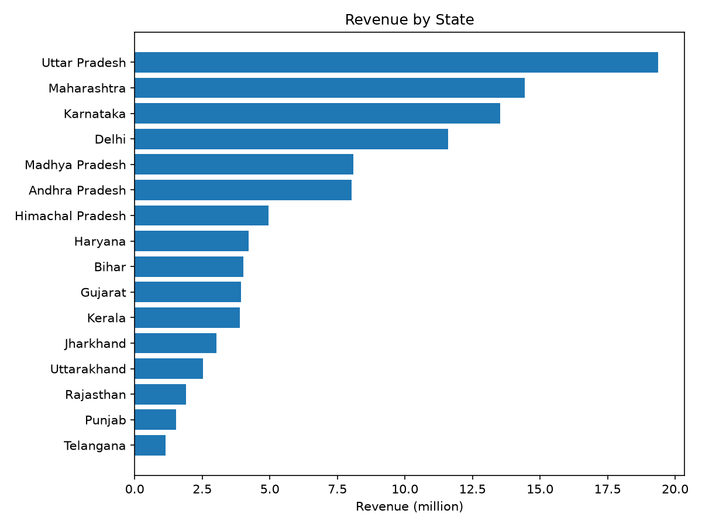
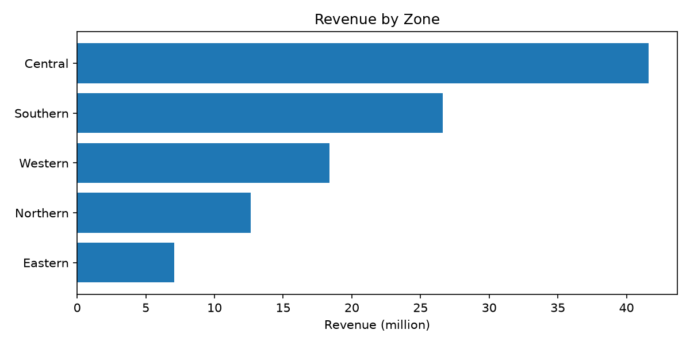
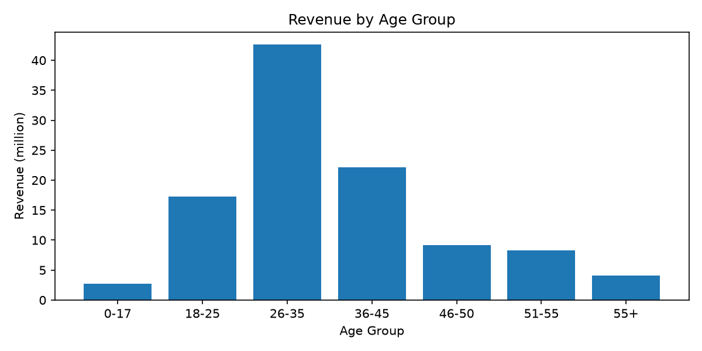
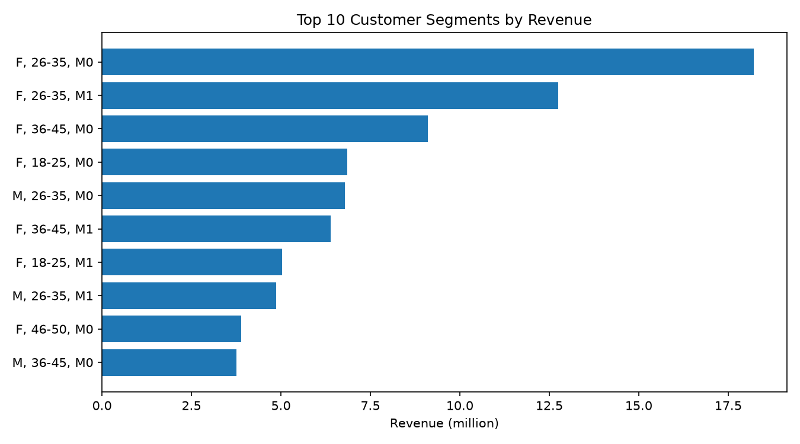

# Diwali Sales Analysis

Exploratory data analysis of Diwali sales data using Python (pandas, matplotlib).

> 🚧 Work in progress. Data cleaning is complete, exploratory analysis is in progress (Q3 of 5 done).

## Business Questions

- [x] 1. **Product:** Which Product_Category generates the most revenue, and what share of total revenue does each category contribute?
- [x] 2. **Location:** Which States and Zones generate the highest and lowest revenue?
- [x] 3. **Customer segments:** Which segment (Gender + Age Group + Marital_Status) spends the most, and which spends the least?
- [ ] 4. **Customer concentration:** What percentage of total revenue comes from the top 10% of customers?
- [ ] 5. **Recommendation:** Which categories, States and segments should receive more marketing budget, and why?

## Dataset

Source: [Diwali Sales Dataset on Kaggle](https://www.kaggle.com/datasets/bharathid8/diwali-sales-dataset) (by bharathid8).

- **Raw file:** 11,251 rows, 15 columns
- **File encoding:** not UTF-8, load the raw file with `encoding="latin-1"`
- **Cleaned file:** 11,239 rows, 13 columns (UTF-8)

### Columns

| Column (raw) | Column (cleaned) | Description |
|---|---|---|
| User_ID | User_ID | Customer identifier |
| Cust_name | Customer_Name | Customer name |
| Product_ID | Product_ID | Product identifier |
| Gender | Gender | Customer gender (M/F) |
| Age Group | Age_Group | Age bracket |
| Age | Age | Customer age |
| Marital_Status | Marital_Status | 0/1 flag (meaning not stated in the dataset) |
| State | State | Customer state |
| Zone | Zone | Region |
| Occupation | Occupation | Customer occupation |
| Product_Category | Product_Category | Category of the product |
| Orders | Orders | Number of orders |
| Amount | Amount | Purchase amount |
| Status | *(removed)* | Completely empty |
| unnamed1 | *(removed)* | Completely empty |

## Data Understanding

Notebook: [`01_data_understanding.ipynb`](notebooks/01_data_understanding.ipynb)

- `Amount` has **12 missing values**.
- `Status` and `unnamed1` are **completely empty**.
- `Age` goes up to 92.
- Some columns have incorrect data types.
- Some columns need to be renamed.

## Data Cleaning

Notebook: [`02_data_cleaning.ipynb`](notebooks/02_data_cleaning.ipynb). All cleaning is done on a copy, the raw file is never edited.

| Step | Action | Rows after |
|---|---|---|
| 1 | Dropped the empty columns `Status` and `unnamed1` | 11,251 |
| 2 | Renamed `Cust_name` to `Customer_Name` and `Age Group` to `Age_Group` | 11,251 |
| 3 | Removed 12 rows with missing `Amount` (0.1% of the data) | 11,239 |
| 4 | Converted `Age_Group` to category and `Amount` to int (5 values with decimals were rounded) | 11,239 |
| 5 | Checked `Age` against `Age_Group` (see below) | 11,239 |
| 6 | Saved the cleaned dataset to `data/cleaned/diwali_sales_cleaned.csv` | 11,239 |

### Age check

- **Age 92 is valid.** It is consistent with the `55+` group, and 136 rows have an age above 80, all in `55+`.
- **22 rows are inconsistent.** They have `Age` 26 but `Age_Group` 36-45. The correct value is unknown, so they are kept (0.2% of the data). The analysis uses `Age_Group`.

### Known issues left as is

- **8 exact duplicate rows are kept.** There is no Order ID, so they cannot be confirmed as errors or as genuine repeat purchases. They add up to 70,304 in `Amount` (0.07% of total revenue).
- **`State` has a non-breaking space in "Andhra Pradesh".** It does not affect grouping, but filtering by the name typed with a normal space will not match.

## Exploratory Analysis

Notebook: [`03_eda_and_visualization.ipynb`](notebooks/03_eda_and_visualization.ipynb)

**Total revenue in the dataset: 106,249,132** (sum of `Amount`).

## Key Findings

### Q1. Which product categories generate the most revenue?


| Category | Revenue | Share of total |
|---|---|---|
| Food | 33,933,883 | 31.9% |
| Clothing & Apparel | 16,495,019 | 15.5% |
| Electronics & Gadgets | 15,643,846 | 14.7% |
| Footwear & Shoes | 15,575,209 | 14.7% |
| Furniture | 5,440,052 | 5.1% |

- Food alone generates about 32% of total revenue, more than double the second category.
- The top 4 categories (Food, Clothing & Apparel, Electronics & Gadgets, Footwear & Shoes) account for about 77% of revenue. The remaining 14 categories share about 23%.
- **Recommendation:** prioritize inventory and marketing budget on the top 4 categories, and review whether the smallest categories (Office, Veterinary, Hand & Power Tools, each 0.4% or less) justify their stock and shelf space.

### Q2. Which States and Zones generate the most revenue?





| State | Revenue | Share of total |
|---|---|---|
| Uttar Pradesh | 19,374,968 | 18.2% |
| Maharashtra | 14,427,543 | 13.6% |
| Karnataka | 13,523,540 | 12.7% |
| Delhi | 11,603,819 | 10.9% |
| Telangana (lowest) | 1,151,490 | 1.1% |

| Zone | Revenue | Share of total |
|---|---|---|
| Central | 41,600,873 | 39.2% |
| Southern | 26,606,669 | 25.0% |
| Western | 18,373,625 | 17.3% |
| Northern | 12,618,752 | 11.9% |
| Eastern | 7,049,213 | 6.6% |

- The top three States (Uttar Pradesh, Maharashtra, Karnataka) generate about 44.5% of total revenue.
- The Central zone alone contributes 39.2%, while the Eastern zone contributes only 6.6%.
- The highest State (Uttar Pradesh) earns about 16.8 times more than the lowest (Telangana).
- **Recommendation:** prioritize inventory and marketing budget on the top States and the Central zone, and review the Eastern zone separately to decide whether to grow it or limit spending there. This shows where sales are small, not why, since larger States naturally earn more.

### Q3. Which customer segments spend the most?





| Gender | Revenue | Share of total | Avg per purchase |
|---|---|---|---|
| F | 74,335,856 | 70.0% | 9,491 |
| M | 31,913,276 | 30.0% | 9,367 |

| Age group | Revenue | Share of total | Avg per purchase |
|---|---|---|---|
| 0-17 | 2,699,653 | 2.5% | 9,120 |
| 18-25 | 17,240,732 | 16.2% | 9,175 |
| 26-35 | 42,613,443 | 40.1% | 9,384 |
| 36-45 | 22,144,996 | 20.8% | 9,700 |
| 46-50 | 9,207,844 | 8.7% | 9,367 |
| 51-55 | 8,261,477 | 7.8% | 9,954 |
| 55+ | 4,080,987 | 3.8% | 9,557 |

| Marital_Status | Revenue | Share of total | Avg per purchase |
|---|---|---|---|
| 0 | 62,125,386 | 58.5% | 9,531 |
| 1 | 44,123,746 | 41.5% | 9,346 |

| Top segments (Gender, Age group, Marital_Status) | Revenue | Share of total |
|---|---|---|
| F, 26-35, 0 | 18,222,379 | 17.2% |
| F, 26-35, 1 | 12,741,575 | 12.0% |
| F, 36-45, 0 | 9,113,127 | 8.6% |
| F, 18-25, 0 | 6,851,952 | 6.4% |
| M, 26-35, 0 | 6,786,370 | 6.4% |

- Women generate 70% of revenue, and customers aged 26-35 contribute 40.1%. The three groups between 18 and 45 together generate about 77%.
- The best segment (women aged 26-35 with Marital_Status 0) alone generates 17.2% of revenue. The top 5 of the 28 segments generate about 50.6%.
- The average spend per purchase is almost the same in every group (about 9,100 to 10,000). The differences in revenue come from how **often** customers buy, not from how much they spend each time.
- **Recommendation:** focus marketing on women aged 26-45 and on campaigns that increase purchase frequency (bundles, repeat offers), rather than premium pricing. Older groups (51-55, 36-45) spend slightly more per purchase and could be tested with premium offers.
- **Notes:** the meaning of Marital_Status 0 and 1 is not stated in the dataset. The smallest segments have only about 55 to 80 rows, so their figures are less reliable. Charts for Gender and Marital_Status are in the notebook.

*More findings will be added as each question is answered.*

## Project Structure

```
data/
  raw/        original dataset (never edited)
  cleaned/    cleaned dataset
notebooks/
  01_data_understanding.ipynb
  02_data_cleaning.ipynb
  03_eda_and_visualization.ipynb
images/       charts used in this README
```

## How to Load the Data

```python
import pandas as pd

# Cleaned data (UTF-8)
df = pd.read_csv("data/cleaned/diwali_sales_cleaned.csv")
df["Age_Group"] = df["Age_Group"].astype("category")  # category is lost when saving to CSV

# Raw data (not UTF-8)
raw = pd.read_csv("data/raw/diwali_sales_data.csv", encoding="latin-1")
```

## Limitations

- The dataset has no date column, so time-based trends cannot be analyzed.
- Data covers the Diwali period only, so findings should not be generalized to the whole year.
- There is no Order ID, so exact duplicate rows could not be verified as errors or genuine repeat purchases.
- 22 rows have an Age that does not match the Age_Group (kept as is).
- The meaning of `Marital_Status` (0 and 1) is not documented in the dataset.
- Revenue figures are based on the `Amount` column of this dataset only.